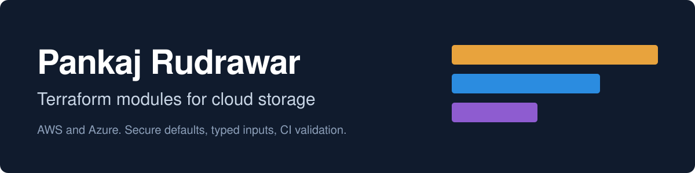

  

# Hi, I'm Pankaj

I'm a cloud storage architect with more than 20 years of experience in enterprise storage, data center migrations and hybrid multi-cloud environments. This account holds the Terraform modules I keep reaching for when building storage on AWS and Azure.

## Terraform modules

Each module has its own repository, a runnable example, pre-commit hooks and a GitHub Actions workflow that runs `terraform fmt`, `validate` and TFLint. The layout follows the [terraform-aws-modules](https://github.com/terraform-aws-modules) collection.

### AWS

| Module | What it does |
|--------|--------------|
| [terraform-aws-efs](https://github.com/pankajrudrawar/terraform-aws-efs) | Amazon EFS with mount targets, access points, lifecycle tiering, backups and an optional security group |
| [terraform-aws-fsx-lustre](https://github.com/pankajrudrawar/terraform-aws-fsx-lustre) | FSx for Lustre, scratch or persistent, with EFA support and an optional S3 data repository link |
| [terraform-aws-fsx-ontap](https://github.com/pankajrudrawar/terraform-aws-fsx-ontap) | FSx for NetApp ONTAP with storage virtual machines, Active Directory join and tiered volumes |
| [terraform-aws-s3-bucket](https://github.com/pankajrudrawar/terraform-aws-s3-bucket) | Locked-down S3 bucket with versioning, encryption, TLS-only policy and lifecycle rules |

### Azure

| Module | What it does |
|--------|--------------|
| [terraform-azurerm-storage-account](https://github.com/pankajrudrawar/terraform-azurerm-storage-account) | Storage account with containers, file shares, lifecycle management and firewall rules |
| [terraform-azurerm-netapp-files](https://github.com/pankajrudrawar/terraform-azurerm-netapp-files) | Azure NetApp Files account, capacity pools, snapshot policies and NFS or SMB volumes |
| [terraform-azurerm-virtual-network](https://github.com/pankajrudrawar/terraform-azurerm-virtual-network) | Virtual network with subnets, delegations, service endpoints and security groups |

Planned next: `terraform-aws-fsx-windows`, `terraform-aws-vpc` and `terraform-azurerm-aks`.

### Contributing

Issues and pull requests are welcome. Each module has a `CONTRIBUTING.md`, issue templates and a Discussions board for questions. The modules are early, so reports with your provider version and a minimal configuration are especially useful.

## Terraform resources

| Topic | Links |
|-------|-------|
| Learn and reference | [Terraform docs](https://developer.hashicorp.com/terraform), [Terraform language](https://developer.hashicorp.com/terraform/language), [Registry](https://registry.terraform.io), [OpenTofu](https://opentofu.org) |
| Providers | [AWS](https://registry.terraform.io/providers/hashicorp/aws/latest/docs), [AzureRM](https://registry.terraform.io/providers/hashicorp/azurerm/latest/docs), [Kubernetes](https://registry.terraform.io/providers/hashicorp/kubernetes/latest/docs) |
| Storage service docs | [EFS](https://docs.aws.amazon.com/efs/), [FSx](https://docs.aws.amazon.com/fsx/), [S3](https://docs.aws.amazon.com/s3/), [Azure Storage](https://learn.microsoft.com/azure/storage/), [Azure NetApp Files](https://learn.microsoft.com/azure/azure-netapp-files/) |
| Reference modules | [terraform-aws-modules](https://github.com/terraform-aws-modules), [Azure Verified Modules](https://azure.github.io/Azure-Verified-Modules/) |
| Quality and security | [TFLint](https://github.com/terraform-linters/tflint), [terraform-docs](https://terraform-docs.io), [pre-commit-terraform](https://github.com/antonbabenko/pre-commit-terraform), [Checkov](https://www.checkov.io), [Trivy](https://trivy.dev) |
| Operations | [Terragrunt](https://terragrunt.gruntwork.io), [Infracost](https://www.infracost.io) |

## Background

My experience spans Dell EMC, NetApp and Pure Storage platforms, AWS and Azure storage services, Kubernetes and infrastructure as code.

**Certifications:** Certified Kubernetes Administrator, AWS Solutions Architect Associate, Azure Solutions Architect, VMware VCP.

The full catalog, with more detail on each module, is at **[pankajrudrawar.github.io](https://pankajrudrawar.github.io)**.
